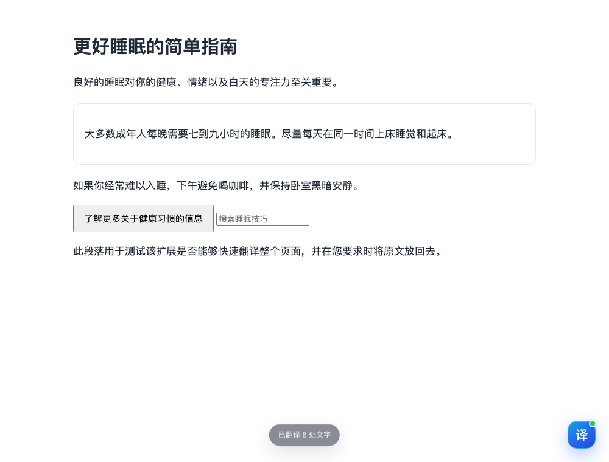
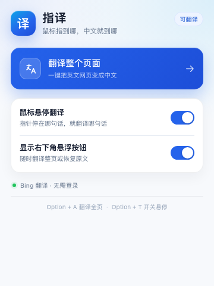

# Point Translate — hover & full-page Chinese translation for Chrome

[简体中文](README.md) | English

Project home: https://github.com/huanyi456-tech/point-translate

A small Manifest V3 extension for people who are not comfortable reading English:

- **Hover to translate** — rest the pointer on an English sentence and a Chinese tooltip appears after about 0.4 s.
- **Translate the whole page** — replace the page text with Chinese while keeping the layout.
- **Restore the original** — switch back to English at any time.
- **No account, no API key.**

Translation text is sent to Bing's web translator, with MyMemory as a fallback. The extension does not collect browsing history or write page content to disk. This project is not affiliated with Microsoft/Bing; it uses their public web translation endpoint, which may change without notice.





## Install (about one minute)

1. Download and unzip `dist/指译-Chrome插件-v1.0.1.zip`.
2. Open `chrome://extensions` in Chrome.
3. Turn on **Developer mode** (top right).
4. Click **Load unpacked** (top left).
5. Select the unzipped **`point-translate-extension`** folder — the one that contains `manifest.json`.
6. Pin the blue **译** icon to the toolbar if you like.
7. **Refresh pages that were already open** before installing.

## Usage

- **Hover:** keep the pointer over an English sentence; the Chinese tooltip appears automatically.
- **Whole page:** click the **译** icon → **翻译整个页面** (Translate this page), click the blue floating button, or press `Option + A` (`Alt + A` on Windows/Linux).
- **Restore:** click the icon → **恢复网页原文** (Restore original).
- **Selection:** select English text → right-click → **翻译选中的文字** (Translate selection).
- **Toggle hover:** click the icon and switch off **鼠标悬停翻译**, or press `Option/Alt + T`.

The interface is in Chinese; the screenshot above shows the popup.

## Privacy

Only the text you actually translate is sent to Bing or MyMemory. There is no account system, no analytics, and no persistent storage of page content. Do not use any online translator on banking, medical, or confidential pages.

## Limitations

- Requires an internet connection.
- Cannot modify `chrome://` pages, the Chrome Web Store, the PDF viewer, or other protected pages.
- Does not translate text inside images, video subtitles, or text typed into inputs.
- `all_frames` is `false`, so cross-origin iframes may not be translated.
- Desktop Chrome/Edge only; mobile Chrome cannot load unpacked extensions.

## Development

The extension has no build step. See the [Chinese README](README.md#五给维护者) for the full test setup. Quick checks:

```bash
node --check extension/background.js
node --check extension/content.js
node --check extension/popup.js
```

The end-to-end test uses Chrome DevTools Protocol and a local fixture:

```bash
python3 -m http.server 8799 --directory tests/fixture
# start Chrome with --remote-debugging-port=9333, then:
node scripts/load-extension.mjs
node scripts/cdp-verify.mjs
```

## License

[MIT](LICENSE).
