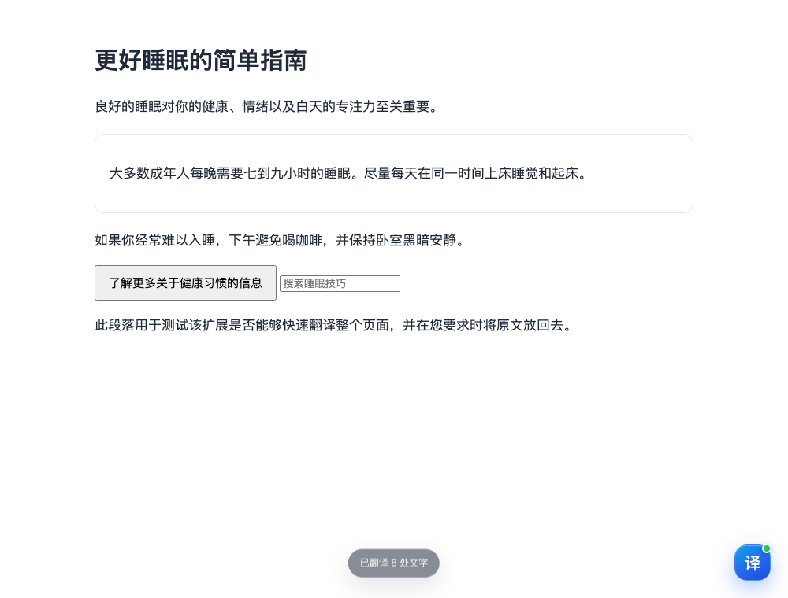
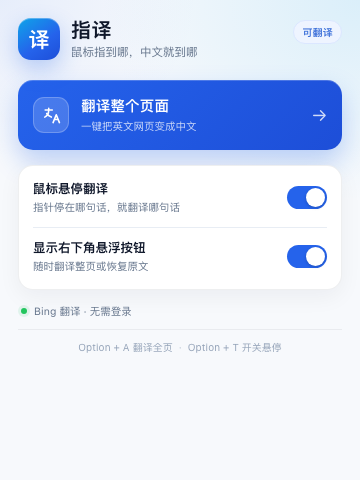

# 指译 — Chrome 悬停翻译 / 整页翻译

[English](README.en.md) | 简体中文

项目主页：https://github.com/huanyi456-tech/point-translate

一个给不熟悉英文的浏览器用户准备的中文翻译插件：

- **鼠标指到哪，中文就翻译到哪**：把鼠标停在一句英文上，约 0.4 秒后旁边会弹出中文。
- **一键翻译整个页面**：把当前英文网页的文字全部换成中文，排版基本不变。
- **随时恢复原文**：翻译后可以一键变回英文，方便对照。
- **不需要账号、不需要 API Key**，安装后即可使用。

> 译文会发送给 Bing 翻译网页接口；Bing 不可用时自动尝试 MyMemory 备用接口。插件不收集、不上传浏览记录，也不保存网页内容。本插件与 Microsoft / Bing 无隶属关系，使用的是其公开网页翻译接口；接口变更可能导致翻译失败。





---

## 一、安装（约 1 分钟）

### Chrome / Edge 电脑版

1. 下载并解压 [`指译-Chrome插件-v1.0.0.zip`](dist/指译-Chrome插件-v1.0.0.zip)。  
   解压后会看到一个文件夹 **`point-translate-extension`**，里面有 `manifest.json`。
2. 在 Chrome 地址栏输入 `chrome://extensions` 并回车。  
   （Edge 输入 `edge://extensions`。）
3. 打开页面右上角的 **“开发者模式”** 开关。
4. 点击左上角 **“加载已解压的扩展程序”**。
5. 选择解压出来的 **`point-translate-extension`** 文件夹。  
   注意：要选到有 `manifest.json` 的这一层，不要选它的上一层。
6. 浏览器右上角出现蓝色的 **“译”** 图标，就说明安装成功。建议点击地址栏旁边的拼图图标，把“指译”固定到工具栏。
7. **刷新安装前已经打开的网页**，插件才会在这些页面生效。

> 安装后如果图标是灰色的，或页面没有反应，先刷新网页；仍然不行就重启一次浏览器。

---

## 二、怎么用

### 1. 鼠标悬停翻译

把鼠标停在一句英文上，不要点击，等约 0.4 秒，旁边会出现中文提示框。

- 提示框里上方是中文，下方是英文原文。
- 如果同一句之前翻译过，第二次悬停会立即显示。
- 不想用悬停时，可以点插件图标，把 **“鼠标悬停翻译”** 关掉。

### 2. 翻译整个页面

任选一种：

- 点击工具栏的 **“译”** 图标 → 点击 **“翻译整个页面”**；
- 点击网页右下角的蓝色 **“译”** 悬浮球 → 点击 **“翻译整个页面”**；
- 按快捷键 **`Option + A`**（Windows 是 `Alt + A`）。

页面右下角会显示“已翻译 N 处文字”。网页是动态加载的（例如往下滚动又出现新内容）时，插件会继续补译。

### 3. 恢复英文原文

- 点击工具栏图标 → **“恢复网页原文”**；
- 或点右下角悬浮球 → **“恢复网页原文”**。

### 4. 翻译选中的文字

用鼠标选中一段英文 → 点右键 → **“翻译选中的文字”**。

### 5. 快捷键

| 功能 | macOS | Windows / Linux |
| --- | --- | --- |
| 翻译整个页面 | `Option + A` | `Alt + A` |
| 开启 / 关闭悬停翻译 | `Option + T` | `Alt + T` |

如果快捷键和别的软件冲突，可以在 `chrome://extensions/shortcuts` 里改。

---

## 三、常见问题

**问：为什么有些页面提示“此页面不能翻译”？**  
Chrome 不允许插件修改 `chrome://` 开头的设置页、Chrome 应用商店、PDF 阅读器等特殊页面。请换普通 `http://` 或 `https://` 网页。

**问：为什么安装后网页没有反应？**  
先刷新网页（`Command + R` / `Ctrl + R`）。安装前就打开的页面不会自动加载插件。

**问：为什么有些文字没翻译？**  
插件会跳过代码块、输入框里已经输入的文字、图片里的文字、视频字幕和跨域嵌入的小窗口。整页翻译主要处理网页正文。

**问：提示翻译服务不可用 / 额度用完？**  
插件优先用 Bing；Bing 失败时会改用 MyMemory。MyMemory 免费版每天有额度，超额后需要等第二天，或稍后重试。请确认电脑能正常上网。

**问：会不会泄露隐私？**  
插件只把你实际翻译的网页文字发给 Bing / MyMemory，不收集账号、不记录浏览历史、不保存网页内容。请不要在网银、公司机密系统等敏感页面使用任何在线翻译插件。

**问：支持手机 Chrome 吗？**  
不支持。Chrome 手机版不能安装这种“加载已解压”的电脑扩展。

---

## 四、卸载

打开 `chrome://extensions` → 找到“指译” → 点击 **“移除”**。

---

## 五、给维护者

插件使用 Manifest V3，无构建步骤，源码即安装包：

```
point-translate/
  extension/          # Chrome 加载这个目录
    manifest.json
    background.js     # Bing / MyMemory 翻译服务、右键菜单、快捷键
    content.js        # 悬停提示、整页翻译、恢复、悬浮球
    popup.html/css/js # 工具栏弹窗
    icons/
  scripts/
    cdp-test.mjs       # 真实 Chrome CDP 快速测试
    cdp-verify.mjs     # 悬停 / 整页 / 动态内容 / 恢复的端到端验收
    load-extension.mjs # 测试用：通过 CDP 加载扩展
  tests/fixture/       # 可复现的 8 处文本测试页
  docs/                # README 截图
  .github/workflows/   # CI：语法检查、manifest 校验、打包
```

### 本地验收

先启动一个静态服务器和一个开启 CDP 的测试 Chrome：

```bash
python3 -m http.server 8799 --directory tests/fixture
```

```bash
"/Applications/Google Chrome.app/Contents/MacOS/Google Chrome" \
  --headless=new --no-sandbox --disable-gpu \
  --remote-debugging-port=9333 \
  --user-data-dir=/tmp/point-translate-test about:blank
```

然后加载扩展并运行验收：

```bash
node scripts/load-extension.mjs
node scripts/cdp-verify.mjs
```

`cdp-verify.mjs` 会验证悬停首次/第二次、关闭悬停、整页 8 处文本、动态内容补译、恢复原文，最后输出 `ALL PASS`。截图默认写入 `tests/shots/`。

只做语法检查：

```bash
node --check extension/background.js
node --check extension/content.js
node --check extension/popup.js
```

已知限制：不翻译 PDF、图片内文字、视频字幕、输入框里手动输入的内容；`all_frames` 为 `false`，跨域 iframe 中的文字可能不翻译。

## 六、开源协议

[MIT](LICENSE)。欢迎提交 Issue 和 Pull Request。
